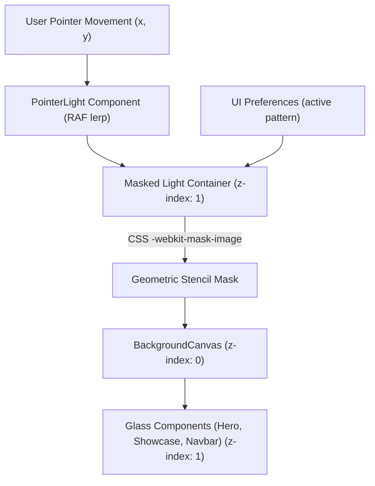

# Stencil & Pattern Masking for Pointer Light Effect 💡📐

## Objective
Enhance the portfolio's ambient pointer spotlight by constraining it through geometric stencil masks. Instead of casting an open circular glow across the entire canvas that washes out subtle strokes, the light must sit strictly behind the active background pattern, shining *only* through its geometric lines, dots, and translucent facets while dark negative spaces completely occlude the light.

---

## Problem Statement & Context
- In the current implementation, `<PointerLight />` sits at `z-index: 1` inside `<BackgroundCanvas />`, with the pattern layer at `z-index: 2`.
- However, because the pattern layer is largely transparent (e.g. `diamond-alternate` uses faint 2% gray polygons and transparent gaps), the 700px radial gradient shines through the open canvas unobstructed.
- This creates the optical appearance of a floating flashlight orb sitting in front of the pattern, washing out the pattern's delicate strokes.

---

## Architectural Solution: Dynamic Pattern Masking



### Stencil Mask Specifications per Pattern

| Pattern Key | Pattern Name | Mask Implementation | Visual Behavior |
| :--- | :--- | :--- | :--- |
| `diamond-alternate` | Alternating Diamond | SVG stencil `<polygon points='20,0 40,20 20,40 0,20' fill='white' stroke='white' stroke-width='1.5'/>` | Only the alternate diamonds and border strokes illuminate; dark diamonds remain solid and block the light. |
| `diamond` | Isometric Diamond Mesh | Repeating diagonal linear gradients at `45deg` and `-45deg` | Light travels strictly along the diagonal wireframe diamond lines. |
| `ruler-grid` | Default Ruler Grid (24px) | Orthogonal linear gradient grid lines (`1.5px`) | Light beams through the 24px technical grid lines. |
| `dualGrid` | Architectural Dual Grid | Dotted 24px subdivisions + dashed 120px major grid | Light illuminates blueprint grid lines and intersections. |
| `dots` | Matrix Dot Grid | Repeating `radial-gradient` dots | Dots light up like vibrant neon LED nodes under the cursor. |
| `crosshair` | Cyber Crosshair Matrix | SVG crosshair stencil | Cyber crosshair marks illuminate with high contrast. |
| `isometric-cubes` | 3D Wireframe Cube Voxels | SVG isometric cube wireframe | 3D voxel edges glow as the pointer moves across. |

---

## Implementation Steps

### 1. Update [BackgroundCanvas.tsx](file:///Users/rehman/Documents/Nebula/md-rehman.dev/repo/md-rehman.dev/apps/home/app/components/v2/background/BackgroundCanvas.tsx)
- Wrap `<PointerLight />` in a container that dynamically applies the matching pattern mask class:
  ```tsx
  <div className={`${styles.lightMaskContainer} ${getPatternMaskClass()}`}>
    <PointerLight />
  </div>
  ```

### 2. Update [BackgroundCanvas.module.css](file:///Users/rehman/Documents/Nebula/md-rehman.dev/repo/md-rehman.dev/apps/home/app/components/v2/background/BackgroundCanvas.module.css)
- Define `.lightMaskContainer` with `position: absolute; inset: 0; z-index: 1; pointer-events: none; overflow: hidden;`.
- Add `-webkit-mask-image` and `mask-image` rules corresponding to each pattern variant.

### 3. Adjust Optics in [PointerLight.module.css](file:///Users/rehman/Documents/Nebula/md-rehman.dev/repo/md-rehman.dev/apps/home/app/components/v2/effects/PointerLight.module.css)
- Because the light is now cleanly constrained within geometric lines and facets rather than spilling as a muddy blob, increase center opacity from `0.2` to `0.4 - 0.45` for crisp, radiant luminescence.

---

## Verification Checklist
- [x] Hover over `diamond-alternate`: Confirm dark diamonds stay opaque and only wireframe strokes glow.
- [x] Switch patterns in `InspectorModal`: Confirm each pattern masks the pointer light cleanly.
- [x] Verify glass cards (`GlassHero`, `GlassAppCard`): Light diffuses smoothly through frosted glass.
- [x] Confirm 60/120 FPS performance with zero React re-renders during pointer movement.
- [x] Test `@media (hover: none)` on touch devices and `prefers-reduced-motion`.

