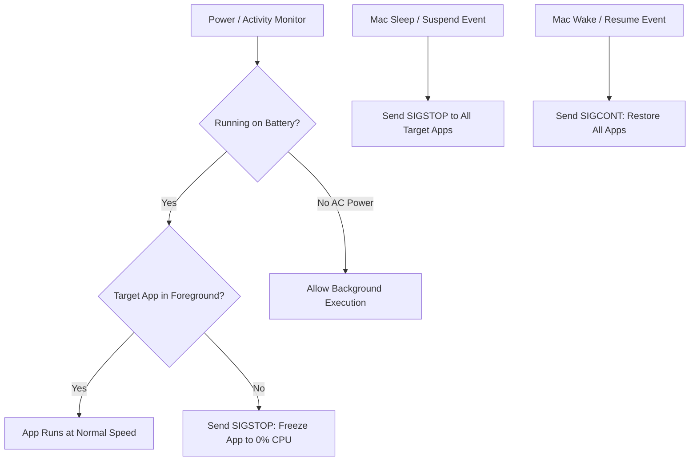

# Let Me Sleep (`LetMeSleep.app`)
> *"Tell greedy apps to pause so your Mac can sleep in peace."*

---

## 1. Executive Summary

| Attribute | Details |
| :--- | :--- |
| **Product Name** | **Let Me Sleep** (Executable: `LetMeSleep.app`, Repo: `let-me-sleep`) |
| **Category** | macOS Menu Bar Utility / Power & Battery Management |
| **License** | 100% Free & Open-Source (MIT or Apache 2.0) with optional donation/sponsor link |
| **Target Audience** | Developers, power users, and MacBook users running heavy apps (Electron, IDEs, browsers, local LLMs) |
| **Core Value Proposition** | Safely freezes (`SIGSTOP`) power-hungry background apps when running on battery or when the Mac sleeps, and instantly unfreezes (`SIGCONT`) them when brought to the foreground—with zero data loss or restarts. |

---

## 2. Background & Problem Statement

### 2.1 The Real-World Incident
Modern developer workflows rely heavily on Electron apps (VS Code, Antigravity IDE, Slack, Discord) and Chromium. During a real-world debugging session:
* **Antigravity IDE** registered an **Energy Impact of ~4,000** and held **Preventing Sleep: Yes** in Activity Monitor.
* The culprit was a single background webview: `Antigravity IDE Helper (Renderer)` holding a persistent sleep assertion, along with a child `Google Chrome` automation process.
* Even with macOS battery settings configured to *"Wake for network access: Only on Power Adapter"*, the MacBook continued to drain battery rapidly while sleeping.

### 2.2 Why macOS Fails to Sleep Peacefully
1. **Sleep Assertions & DarkWake:** When an app acquires a `PreventUserIdleSystemSleep` power assertion, macOS does not enter deep sleep when the display turns off. Instead, it enters **DarkWake**—running background threads, WebSockets, and timers in the dark.
2. **`tcpkeepalive` on Battery:** macOS maintains background TCP connections during sleep by default, repeatedly waking up the CPU to process socket activity.
3. **App Nap Inefficiency:** macOS App Nap only activates when windows are completely occluded or minimized. If an app window remains on a virtual space, it runs at full foreground power.
4. **Activity Monitor’s Limitation:** Activity Monitor shows what is draining energy, but its only tool is **Force Quit (kill -9)**, which destroys unsaved work and terminal sessions.

---

## 3. Core Mechanics & Architecture

### 3.1 Non-Destructive Process Suspension
Instead of quitting apps, **Let Me Sleep** uses standard Unix signals:
* **Freeze (`SIGSTOP` / `kill -STOP <PID>`):** The OS pauses the process instantly. CPU usage drops to **0.00%**, background timers halt, power assertions are neutralized, and battery draw ceases. Memory state remains intact in RAM.
* **Thaw (`SIGCONT` / `kill -CONT <PID>`):** The OS immediately resumes execution. The app continues seamlessly without reloading or restarting.



### 3.2 Power State & Event Triggers
1. **Battery vs. AC Adapter (`powerMonitor`):**
   * On **AC Adapter (Charging):** Background compilation, indexing, and agent runs proceed unrestricted.
   * On **Battery:** Background processes lose priority; inactive target apps are frozen after a grace period.
2. **System Sleep / Suspend (`powerMonitor.on('suspend')`):**
   * Fires the moment the lid closes or sleep is initiated, guaranteeing that no rogue helper prevents deep sleep.
3. **Focus Switching (`NSWorkspace` / AppleScript):**
   * Detects the frontmost application. When the user switches back to a frozen app, `SIGCONT` unfreezes it within milliseconds.

---

## 4. Product Features & User Experience

```
+-------------------------------------------------------------+
|  [Menu Bar Icon: 🌙 / ⏸️]                                   |
+-------------------------------------------------------------+
|  Let Me Sleep                     ⚡ Power: Battery (84%)   |
|  Status: 2 Apps Frozen (Saving ~3,800 Energy Impact)        |
+-------------------------------------------------------------+
|  TOP ENERGY IMPACT                                          |
|  [⏸️ PAUSED]  Antigravity IDE Helper   (Energy: 3,910.7)    |
|  [⏸️ PAUSED]  Google Chrome Helper     (Energy: 412.3)      |
|  [▶️ ACTIVE]  Slack Helper             (Energy: 85.1)       |
|  [▶️ ACTIVE]  Docker Desktop           (Energy: 62.0)       |
+-------------------------------------------------------------+
|  QUICK ACTIONS                                              |
|  [ Freeze All Background Apps ]     [ Resume All ]          |
+-------------------------------------------------------------+
|  ⚙️ Preferences & Rule Engine...                            |
|  ❌ Quit Let Me Sleep                                       |
+-------------------------------------------------------------+
```

### 4.1 Tier 1: Menu Bar Popup (Lightweight Action Center)
* **Live Energy Drain List:** Displays the top 3–5 processes ranked by macOS Energy Impact.
* **1-Click Action Buttons:**
  * **Freeze / Resume Toggle:** Instant manual toggle per app.
  * **Pin / Whitelist:** Keep specific apps (e.g., Spotify, Discord calls) always active.
* **Status Badges:** Shows current power source (Battery vs. AC) and number of suspended apps.

### 4.2 Tier 2: Preferences & Rules Engine Window
* **Auto-Freeze Trigger:** Configure idle timeout (e.g., *"Freeze target apps when in background for > 60 seconds on battery"*).
* **Sleep Guard:** Automatically freeze all blacklisted apps the instant macOS triggers sleep.
* **Whitelist & Blacklist Rules:**
  * **Always Safe (Whitelist):** Audio players, active downloads, system services.
  * **Aggressive Freeze (Blacklist):** IDE renderers, browser helpers, unused dev servers.
* **Apple Silicon QoS Throttling (Optional Advanced Mode):**
  * Demote background apps to efficiency cores using macOS QoS (`taskpolicy -b -p <PID>`) instead of full `SIGSTOP`.

---

## 5. Technology Stack Evaluation

| Metric | Option A: Electron | Option B: Tauri v2 (Rust + Web) | Option C: Native Swift / SwiftUI |
| :--- | :--- | :--- | :--- |
| **Development Speed** | 🚀 Extremely fast (Node.js ecosystem) | ⚡ Fast (Rust + React/Svelte) | ⏱️ Moderate (Apple ecosystem) |
| **RAM Footprint** | ~100 MB – 150 MB | ~25 MB – 40 MB | ~10 MB – 15 MB |
| **Mac Community Perception** | Mixed (irony of using Electron to save battery) | High (praised for modern efficiency) | Best (native macOS gold standard) |
| **Recommendation** | **Best for v1 Proof of Concept / MVP** | **Best balanced cross-over** | **Best long-term v2 rewrite** |

> [!TIP]
> **MVP Strategy:** Build v1 in **Electron** (or a pure Node.js background CLI) to validate the core process monitoring and freezing algorithms quickly. If community demand grows, migrate the UI shell to **Tauri** or **SwiftUI** for maximum efficiency.

---

## 6. Implementation Prototype (Electron Starter)

```javascript
// main.js - Let Me Sleep MVP
const { app, Tray, Menu, powerMonitor } = require('electron');
const { exec } = require('child_process');

let tray = null;
let pausedApps = new Set();
const TARGETS = ['Antigravity IDE', 'Google Chrome'];

function freezeApp(name) {
  exec(`pkill -STOP -f "${name}"`, (err) => {
    if (!err) {
      pausedApps.add(name);
      updateMenu();
    }
  });
}

function unfreezeApp(name) {
  exec(`pkill -CONT -f "${name}"`, (err) => {
    if (!err) {
      pausedApps.delete(name);
      updateMenu();
    }
  });
}

function getFrontmostApp() {
  return new Promise((resolve) => {
    exec(`osascript -e 'tell application "System Events" to get name of first application process whose frontmost is true'`,
      (err, stdout) => resolve(err ? '' : stdout.trim()));
  });
}

async function evaluateRules() {
  const onBattery = powerMonitor.isOnBatteryPower();
  const frontApp = await getFrontmostApp();

  for (const target of TARGETS) {
    const isForeground = frontApp.includes(target);
    if (onBattery && !isForeground && !pausedApps.has(target)) {
      freezeApp(target);
    } else if ((!onBattery || isForeground) && pausedApps.has(target)) {
      unfreezeApp(target);
    }
  }
}

function updateMenu() {
  if (!tray) return;
  const onBattery = powerMonitor.isOnBatteryPower();
  const contextMenu = Menu.buildFromTemplate([
    { label: `Let Me Sleep (Power: ${onBattery ? 'Battery' : 'AC'})`, enabled: false },
    { type: 'separator' },
    ...TARGETS.map(name => ({
      label: `${pausedApps.has(name) ? '⏸️ Paused' : '▶️ Active'}: ${name}`,
      click: () => pausedApps.has(name) ? unfreezeApp(name) : freezeApp(name)
    })),
    { type: 'separator' },
    { label: 'Quit', click: () => { TARGETS.forEach(unfreezeApp); app.quit(); } }
  ]);
  tray.setContextMenu(contextMenu);
}

app.whenReady().then(() => {
  if (app.dock) app.dock.hide();
  tray = new Tray('/System/Library/CoreServices/CoreTypes.bundle/Contents/Resources/ToolbarCustomizeIcon.icns');
  updateMenu();

  powerMonitor.on('suspend', () => TARGETS.forEach(freezeApp));
  powerMonitor.on('resume', evaluateRules);
  powerMonitor.on('on-battery', evaluateRules);
  powerMonitor.on('on-ac', () => TARGETS.forEach(unfreezeApp));

  setInterval(evaluateRules, 5000);
});

app.on('before-quit', () => TARGETS.forEach(unfreezeApp));
```

---

## 7. Competitive Landscape

| Tool | Price | Process Freezing | Battery Awareness | Modern UI |
| :--- | :--- | :--- | :--- | :--- |
| **Let Me Sleep** | **Free & Open Source** | **Yes (`SIGSTOP`)** | **Yes (Auto-trigger)** | **Yes (Menu Bar)** |
| **App Tamer** | Paid ($14.95) | Yes | Yes | Outdated UI |
| **Endurance** | Paid ($20.00) | Throttle only | Yes | Minimal |
| **AppFreeze** | Freemium | Yes | Limited | Yes |
| **Stats / iStat** | Free / Paid | No (Monitor only) | No | Yes |
| **AppPolice** | Free (GitHub) | Throttle only | No (Manual) | Abandoned |

---

## 8. Phased Development Roadmap

### Phase 1: MVP (Proof of Concept)
- [ ] Initialize repository: `let-me-sleep`
- [ ] Implement macOS power state listener (`powerMonitor` for AC vs. Battery).
- [ ] Implement `pmset -g batt` and `top -stats pid,command,power` parser.
- [ ] Implement robust `SIGSTOP` / `SIGCONT` wrapper functions.
- [ ] Build minimalist Menu Bar Tray interface.

### Phase 2: Rules & Preferences Window
- [ ] Add editable Whitelist and Blacklist.
- [ ] Configurable idle timeout sliders (immediate, 30s, 60s, 5m).
- [ ] Auto-suspend on lid close / macOS sleep assertion override.
- [ ] Clean process crash handling (ensure all apps unfreeze upon exit).

### Phase 3: Packaging & Release
- [ ] Design official app icon (moon 🌙 / sleepy Mac face).
- [ ] Set up GitHub Actions CI for macOS `.dmg` and `.zip` builds.
- [ ] Add Homebrew Cask formula (`brew install --cask let-me-sleep`).
- [ ] Launch announcement on Reddit (`r/macapps`, `r/mac`, `r/opensource`) and Hacker News.
